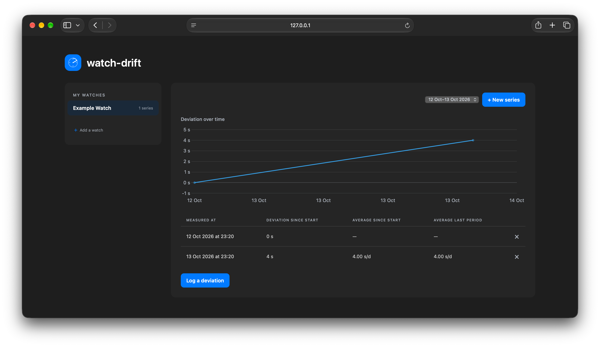

# watch-drift

A small local web app for tracking the accuracy of mechanical watches. Flask serves the page and a small JSON API; all data is stored in SQLite in `watches.db`.



## Getting started

Requires Python 3.9 or newer.

```sh
python3 -m venv .venv
source .venv/bin/activate
pip install -r requirements.txt
python app.py
```

Then open http://127.0.0.1:5000 in your browser. The database is created automatically the first time the app starts. Stop the server with Ctrl+C.

## How to use it

1. Add a watch and select it from the list.
2. Set the watch using a reliable time source, then start a measurement series. The series is automatically labelled with its date range in the interface.
3. When you check the watch again, enter its deviation from the reference time in seconds. A minus value means the watch is running slow; a plus value means it is running fast.

The app calculates the change in deviation between measurements as seconds per day. This is a simple measurement, so the result depends on how accurately you can read both the reference time and the watch.

## Local access

The app uses Waitress and listens only on `127.0.0.1:5000`, so it is reachable only from the machine running it. There is no sign-in screen. Keep it local unless you add suitable access controls before allowing other devices to connect.
